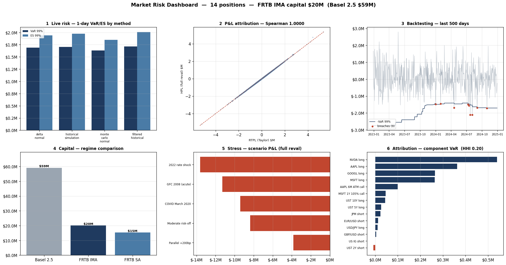

# Market Risk Engine

A multi-asset market-risk system for a sell-side trading book, implemented end to
end across nine phases: from raw market data through sensitivities, VaR/ES, FRTB
backtesting, stress testing, risk attribution, and finally a single regulatory
capital number under both Basel III and FRTB. It is built around one organising
idea — a **closed loop** in which every measure feeds the next, so the capital
figure at the end is consistent with the risk factors at the start.

## What it demonstrates

On a real 14-position multi-asset book the engine produces one consistent capital
number end to end — and, the part that matters for a risk seat, the **backtesting
catches what an average-rate test misses**: Christoffersen's independence test
flags exception *clustering* (the failure mode that shows up inside a single
stress window) even when Kupiec's unconditional rate looks acceptable. The
dashboard below shows 1-day VaR/ES across four methods, the P&L-attribution check,
backtesting with the breach count and traffic-light, the Basel-vs-FRTB capital
comparison, stress-scenario P&L, and the component-VaR attribution.



*End-to-end risk dashboard on the US book, regenerated by the pipeline from cached market data. FRTB IMA capital \$20.1M vs Basel 2.5 \$59.1M; trailing-250-day backtest amber (9 exceptions, IMA retained); component-VaR concentration HHI 0.20.*

The reference book is a 14-position US trading book: five long single-name
equities (AAPL, MSFT, NVDA, GOOGL, and a JPM short), two long equity options, the
2y/5y/10y UST curve, a short US IG credit position, and three FX pairs. An EU book
of identical structure is also provided — geography lives only in the data
fetchers and the book definition, not in the engine.

## Live dashboard

Two ways to see the engine's output, both driven by the same modules:

- **Interactive app — `app.py` (Streamlit).** Six live tabs — live risk, P&L
  attribution (PLA), backtesting, capital, stress, attribution — with confidence
  and window controls. It runs entirely on the bundled `data_cache/`, so there is
  no network call and no API key required.
  ```bash
  pip install -r requirements.txt
  streamlit run app.py
  ```
- **Static six-panel report — `risk_dashboard.png`.** The matplotlib desk view
  shown above, regenerated by `python -m examples.phase9_demo`.

The interactive app and the static PNG share a palette on purpose, so the two read
as one product rather than two.

## Status

| Phase | Module | Status |
|---|---|---|
| 1 | Data layer & portfolio definition | Complete |
| 2 | Greeks & risk-theoretical P&L | Complete |
| 3 | VaR engine (parametric, historical, Monte Carlo, filtered HS) | Complete |
| 4 | FRTB Expected Shortfall with liquidity horizons | Complete |
| 5 | P&L Attribution test + SbM standardised charge | Complete |
| 6 | Backtesting suite (Kupiec, Christoffersen, traffic light) | Complete |
| 7 | Stress testing (historical & hypothetical scenarios) | Complete |
| 8 | Component VaR, marginal VaR, concentration | Complete |
| 9 | Regulatory capital (Basel III vs FRTB) + dashboard | Complete |

## The closed loop

```
   positions + market data            (Phase 1)
            │
            ▼
   sensitivities  Δ Γ V ρ θ            (Phase 2)
            │
            ├──────────────► RTPL  (Taylor / risk-theoretical P&L)
            │                          │
   full revaluation ──► HPL            │   (Phase 2 / 5)
            │                          │
            ▼                          ▼
   VaR (4 methods) + FRTB ES   ◄───────┘   (Phase 3 / 4)
            │
            ▼
   backtesting → traffic-light multiplier   (Phase 6)
            │
            ▼
   stressed-period calibration (worst 250d)  (Phase 7)
            │
            ▼
   component / marginal VaR + concentration  (Phase 8)
            │
            ▼
   regulatory capital: Basel 2.5 vs FRTB IMA vs SA   (Phase 9)
```

Two P&L streams run through the whole system. The **RTPL** (risk-theoretical P&L)
is the Taylor/sensitivities reconstruction in `greeks/pnl_attribution.py`; the
**HPL** (hypothetical P&L) is the full front-office revaluation in
`frtb/actual_pnl.py`. The FRTB PLA test compares them; the VaR/ES engines run on
the RTPL distribution; the capital layer consumes the backtesting multiplier, the
stressed ES, and the SbM charge that the earlier phases produce.

## Architecture

```
market-risk-engine/
├── data/                      # Risk factors, instruments, portfolios, market data
│   ├── risk_factors.py        # RiskFactor / RiskFactorSet, native-unit conventions
│   ├── portfolio.py           # Instrument hierarchy, Position, Portfolio
│   ├── market_data.py         # FRED / yfinance fetchers (+ on-disk cache)
│   ├── book_us.py             # US trading book (14 positions)
│   └── book_eu.py             # EU trading book (parallel structure)
├── greeks/                    # Sensitivities + risk-theoretical P&L
│   ├── sensitivities.py       # Δ, Γ, V, ρ, θ per (position, risk factor)
│   └── pnl_attribution.py     # Taylor-expansion P&L = RTPL  (+ by-greek/-position/-RF)
├── var/                       # VaR engines, common 250d window
│   ├── types.py               # Shared VaRResult schema
│   ├── parametric.py          # Delta-normal
│   ├── historical.py          # Historical simulation
│   ├── monte_carlo.py         # Multivariate-normal / multivariate-t (shared χ² mixing)
│   ├── filtered_hs.py         # GARCH(1,1) filtered HS
│   └── var_engine.py          # Unified facade (run_all_methods)
├── frtb/                      # FRTB measures
│   ├── liquidity_horizons.py  # LH band partitioning
│   ├── expected_shortfall.py  # 97.5% ES, LH-scaled to the 10-day base horizon
│   ├── actual_pnl.py          # HPL via full revaluation (compute_hpl)
│   ├── pla_test.py            # P&L Attribution test (Spearman + KS, MAR32)
│   ├── stressed_calibration.py# Rolling-window stressed-period search
│   └── sbm_capital.py         # Standardised approach (SbM), 3 correlation scenarios
├── backtest/                  # Backtesting & multiplier
│   ├── exceptions.py          # Rolling VaR exception stream
│   ├── coverage_tests.py      # Kupiec POF + Christoffersen independence/CC
│   ├── traffic_light.py       # Basel & FRTB multipliers from exception count
│   └── backtest_engine.py     # One VaR, tested vs RTPL and HPL
├── stress/                    # Scenario analysis
│   ├── scenarios.py           # GFC / COVID / 2022 / supervisory shocks
│   └── scenario_engine.py     # Full-reval headline + greek decomposition + residual
├── attribution/               # Risk attribution
│   ├── component_var.py       # Euler component VaR + marginal + incremental
│   ├── concentration.py       # Herfindahl, effective-N, diversification ratio
│   └── attribution_engine.py  # Parametric vs historical, side by side
├── capital/                   # Capital aggregation & reporting
│   ├── regulatory_capital.py  # Basel 2.5 vs FRTB IMA vs SA
│   └── dashboard.py           # Six-panel matplotlib desk view
├── app.py                     # Interactive Streamlit dashboard (six tabs)
├── examples/                  # phase4_demo … phase9_demo (run with -m, illustrative)
├── tests/                     # pytest suite (synthetic, hermetic) + GitHub Actions
├── verify_fred.py             # FRED API-key check (for live pulls)
├── risk_dashboard.png         # Sample dashboard output
├── requirements.txt
├── sources.md                 # Data provenance and methodology references
├── data_cache/                # Bundled RF history for offline runs (use_cache=True)
├── LICENSE
└── README.md
```

## Quick start

```bash
python -m venv .venv && source .venv/bin/activate
pip install -r requirements.txt

# Interactive dashboard (uses the bundled data_cache, no keys, no network):
streamlit run app.py

# Or reproduce any phase end to end from the command line:
python -m examples.phase4_demo    # FRTB ES + stressed calibration
python -m examples.phase5_demo    # PLA test + SbM standardised charge
python -m examples.phase6_demo    # backtesting + traffic-light multiplier
python -m examples.phase7_demo    # stress scenarios
python -m examples.phase8_demo    # component/marginal VaR + concentration
python -m examples.phase9_demo    # Basel vs FRTB capital + regenerate the dashboard
```

The repository ships with `data_cache/` (a small set of cached daily series for
the reference book), so everything above runs offline with **no API key**. For a
live data pull instead, sign up for a free FRED key
(`https://fredaccount.stlouisfed.org/apikeys`), `export FRED_API_KEY=...`, run
`python verify_fred.py`, and call the builders with `use_cache=False`.

```python
from data.market_data import build_us_risk_factor_set
from data.book_us import build_book
from greeks.sensitivities import build_sensitivities
from capital.regulatory_capital import compute_regulatory_capital

rfs  = build_us_risk_factor_set(start="2010-01-01", end="2024-12-31", use_cache=True)
pf   = build_book(rfs)
sens = build_sensitivities(pf)
print(compute_regulatory_capital(pf, sens).summary())
```

## Headline results (reference US book)

| Measure | Value |
|---|---|
| VaR, 1-day 99% (range across the four methods) | $1.63M – $1.72M |
| VaR, 1-day 99% (historical simulation) | $1.71M |
| VaR, 10-day 99% | $5.39M |
| Stressed VaR, 10-day (worst window 2020-02 → 2021-02) | $9.96M |
| FRTB ES, 10-day 97.5% | $5.61M |
| Stressed ES / IMCC, 10-day | $10.47M |
| Backtest (trailing 250d, 99%) | Amber, 9 exceptions, IMA retained |
| Basel multiplier / FRTB multiplier | 3.85 / 1.92 |
| **Basel 2.5 capital** | **$59.1M** |
| **FRTB IMA capital** | **$20.1M** (34% of Basel) |
| FRTB SA (SbM, high-correlation scenario) | $15.3M |

Three findings are worth calling out, because they are what the engine exists to
surface:

- **The regime shift cuts capital here.** FRTB IMA is ~34% of Basel 2.5 for this
  book, because Basel double-counts (VaR *plus* stressed VaR, each ×3.85) while
  FRTB charges a single stressed ES at a roughly-halved multiplier (1.92). The
  well-documented industry-level capital *increases* under FRTB come mostly from
  desks pushed onto the punitive Standardised Approach, not from desks that retain
  model approval.

- **Stress finds a risk that VaR cannot.** The worst named scenario is the **2022
  rate shock (−$13.6M)**, ahead of GFC (−$11.3M) and COVID (−$9.4M), even though
  GFC has the larger raw equity loss. The reason is a sign flip on the UST book:
  bonds rally in GFC/COVID (flight to quality, a hedge) but sell off in 2022 (a
  headwind) — an ~$8M swing on the same positions.

- **Diversification depends on which tail you look at.** NVDA alone carries ~32% of
  VaR and the top three names 68% (Herfindahl 0.198, an effective 5 of 14
  positions). And the parametric and historical component-VaR decompositions
  *disagree on the sign* of the bonds, the JPM short, and the IG short: small risk
  adders under the Gaussian/average-correlation view, but hedges in the empirical
  loss tail (where flight-to-quality and risk-off make them pay off). The long
  option positions flip the same way through convexity.

## Known simplifications

These are deliberate scope choices, documented inline at each site, not
oversights:

- **SbM is one bucket per risk class.** It applies the prescribed MAR21 within-bucket
  correlations (GIRR tenor matrix, 25% large-cap equity, 60% FX) and the three
  correlation scenarios, but omits the full bucket taxonomy, the curvature charge,
  and most vega. The SA is therefore understated, so the SA-below-IMA ordering for
  this book should not be over-read; in production SA is usually a conservative
  floor above IMA.
- **`VaR_avg60` / `IMCC_avg60` are proxied by the current value** rather than a
  trailing-60-day average of the measure; since the multipliers exceed 1, the
  multiplier term binds and `K ≈ m × (current measure)`.
- **VIX is used as a single-name equity-vol proxy** for the option vega; the EU
  book uses an EWMA realised-vol proxy on SX5E (RiskMetrics λ = 0.94), since free
  VSTOXX history is not available programmatically.
- **Component/marginal VaR is delta-normal** — options enter through delta only
  (the historical decomposition does carry their convexity).
- **No default risk charge (DRC), NMRF add-on, or residual risk (RRAO)** — the
  reference book has no non-modellable factors and no defaultable single names
  beyond the IG index.

## Methodology references

See `sources.md` for the full list. Key sources: FRTB (BCBS d457 / MAR), Basel III
VaR-based capital (BCBS d128), Kupiec (1995) and Christoffersen (1998) backtests,
and RiskMetrics (1996) for EWMA volatility.

## Limitations

What the numbers can and cannot tell you:

- **Window dependence.** VaR/ES are estimated on a trailing 250-day window; historical simulation can never exceed the worst day in that window, so genuinely unprecedented tail risk is understated — mitigated, not solved, by the stressed-calibration and ES phases.
- **Backtest honesty.** On the *full* 3,736-day history the 99% model is rejected by the unconditional-coverage test (58 exceptions vs ~37 expected), and 97.5% is borderline; the trailing-250-day window is amber (9 exceptions) and retains IMA. FRTB intentionally sets the multiplier off the rolling window, not the full sample — so the headline traffic light is recent-window by design, and the full-sample rejection is reported rather than hidden.
- **Taylor P&L is checked, not assumed.** The PLA test uses a today-frozen design, so the linear positions reconcile *exactly* by construction (Spearman ≈ 1.00, KS 0.005); the genuine residual is the option book's convexity. Large moves and exotic payoffs would diverge more — the near-perfect rank correlation is a property of this mostly-linear book, not a universal claim about Taylor accuracy.
- **Backtest power.** Exception counts are sample-dependent and the coverage tests have limited power in short windows — a clean traffic light is necessary, not sufficient.
- **Liquidity horizons are simplified.** RF-to-LH assignment follows the MAR33 buckets but does not model name-level liquidity or market impact beyond the horizon scaling.
- **Single daily-close vendor.** No intraday data, no bid-ask, and no liquidity/valuation adjustment beyond the LH treatment.

## Testing

The `tests/` directory holds a `pytest` suite asserting the regulatory and
mathematical identities at the core of the engine. It is driven by fixed-seed
synthetic books, so it runs offline with no market-data calls.

- **VaR / ES** — ES ≥ VaR at matched confidence, exact √-time horizon scaling,
  and an ES/VaR ratio matching the Gaussian closed form on a normal P&L.
- **FRTB ES** — for a single-liquidity-horizon book the aggregated ES equals the
  1-day band ES lifted to the 10-day base horizon by √10 (MAR33).
- **Attribution** — the delta-normal Euler decomposition is exact (component VaR
  sums to portfolio VaR); concentration (HHI / effective-N) is well-formed and
  orders correctly between a balanced and a concentrated book.
- **Backtesting** — Kupiec POF is zero when the exception rate matches the VaR
  level and rejects an excess; Christoffersen conditional coverage decomposes
  exactly as `LR_cc = LR_uc + LR_ind`; the Basel/FRTB traffic-light zones and
  multipliers and the FRTB IMA hard gate map correctly.

```bash
pip install -r requirements-dev.txt
pytest tests/ -q          # 12 tests
```

Tests run automatically on every push via GitHub Actions (`.github/workflows/tests.yml`).

> **`examples/` vs `tests/`** — the phase-by-phase walkthrough scripts live in
> `examples/` and are run from the project root, e.g. `python -m examples.phase5_demo`.
> They are illustrative demos, not assertions; the automated suite is `tests/`.

## License

Use freely for research and educational purposes. No warranty.
